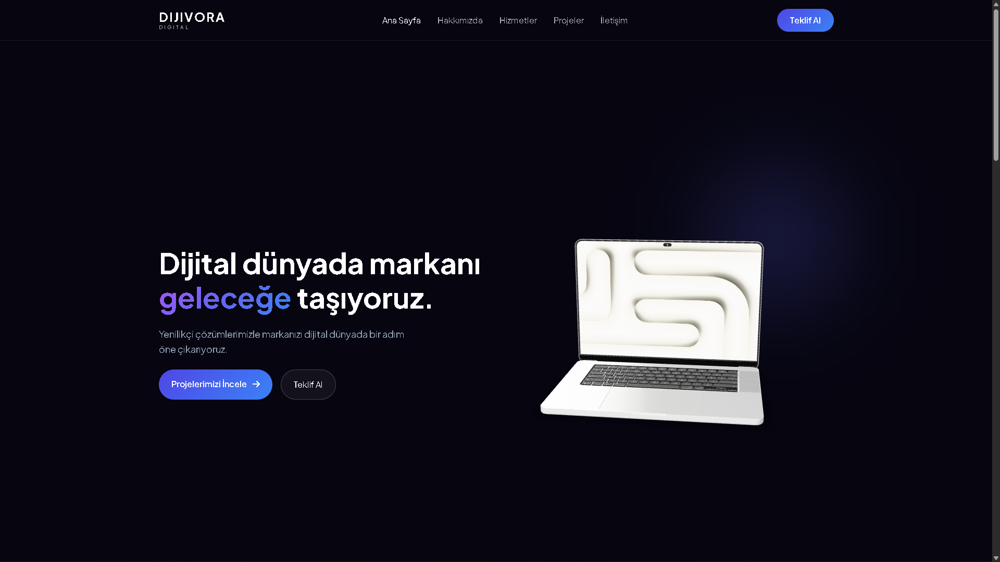
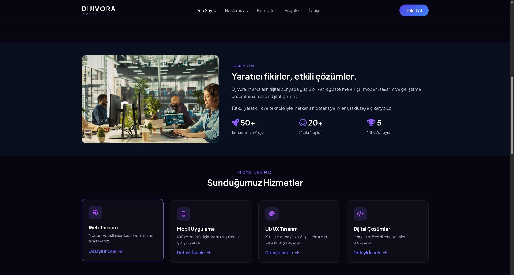
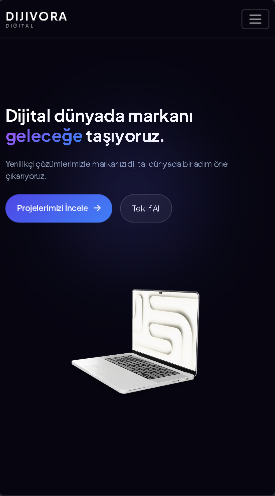

# Dijivora - Modern Ajans Web Sitesi

Dijivora, modern web ve mobil çözümleri sunan yenilikçi bir dijital ajans için hazırlanmış tek sayfalık (single-page) responsive kurumsal web sitesi projesidir.

---

## 📸 Ekran Görüntüleri

### 🖥️ Masaüstü Görünümü (Hero & 3D Model)


### 🖥️ İçerik ve Hizmetler Bölümü


### 📱 Mobil Uyumlu Görünüm
<div align="center">
  
</div>

---

## 🚀 Özellikler

- **Modern & Fütüristik Arayüz:** Koyu tema (dark mode) ve neon gradyan renk paleti ile çağdaş ajans tasarımı.
- **Etkileşimli 3D Model Deneyimi:** Google `<model-viewer>` kütüphanesi ile zenginleştirilmiş 3 boyutlu ürün gösterimi.
- **Tam Duyarlı (Responsive):** Mobil, tablet ve masaüstü ekran boyutları ile tam uyumlu Bootstrap 5 ızgara (grid) altyapısı.
- **SEO & Erişilebilirlik:** Sayfa içi Open Graph etiketleri, meta açıklamaları ve erişilebilir form elemanları.
- **Akıcı Gezinme (Smooth Scroll):** Menü bağlantıları arasında kesintisiz sayfa içi kaydırma deneyimi.

---

## 🛠️ Kullanılan Teknolojiler

- **HTML5 & CSS3**
- **Bootstrap 5.3.3**
- **Google Model Viewer 4.0** (3D Model entegrasyonu)
- **Font Awesome 6.5.1** (Arayüz ikonları)
- **Google Fonts** (Plus Jakarta Sans)

---

## 📁 Proje Dosya Yapısı

```text
├── index.html              # Projenin ana açılış sayfası
├── app.css                 # Özel stil tanımları ve renk teması
├── .gitignore              # Git takip dışı dosyalar listesi
├── assets/
│   ├── 3d_models/          # 3D model ve glTF kaynakları
│   └── images/             # Proje içi görseller ve logo
└── third_party_licenses/   # Kullanılan harici varlıkların lisans bilgileri
```

---

## 💻 Yerel Geliştirme (Nasıl Çalıştırılır?)

1. Bu projeyi bilgisayarınıza klonlayın veya indirin:
   ```bash
   git clone <repo-adresi>
   ```
2. Proje dizinine gidin.
3. `index.html` dosyasını herhangi bir modern tarayıcıda (Chrome, Edge, Firefox vb.) açın ya da bir yerel sunucu (örneğin VS Code Live Server eklentisi) ile başlatın.

---

## 🌐 GitHub Pages ile Yayınlama

Projeyi GitHub Pages üzerinden canlıya almak için:
1. Projenizi GitHub'da bir repoya yükleyin.
2. Repo ayarlarına (**Settings**) gidin.
3. Sol menüden **Pages** seçeneğine tıklayın.
4. **Branch** kısmından `main` (veya `master`) dalını ve `/root` klasörünü seçip kaydedin.
5. Birkaç dakika içinde projeniz `https://<kullanici-adi>.github.io/<repo-adi>/` adresinde yayına girecektir.

---

## 📝 Lisans ve Atıflar

- **Proje:** Eğitim ve portföy amaçlı hazırlanmıştır.
- **3D MacBook Modeli:** Ranguel tarafından tasarlanan [MacBook Ultra Concept](https://sketchfab.com/3d-models/macbook-ultra-concept-5e69cb60df5943cb9f45b7285faa179d) modeli [CC BY 4.0](https://creativecommons.org/licenses/by/4.0/) lisansı altındadır.
- **Model Viewer:** Google tarafından geliştirilen [model-viewer](https://modelviewer.dev/) bileşeni [Apache 2.0](https://www.apache.org/licenses/LICENSE-2.0) lisansı ile kullanılmaktadır.
- Lisans detayları ve tam metinler `third_party_licenses/` dizini altında yer almaktadır.
